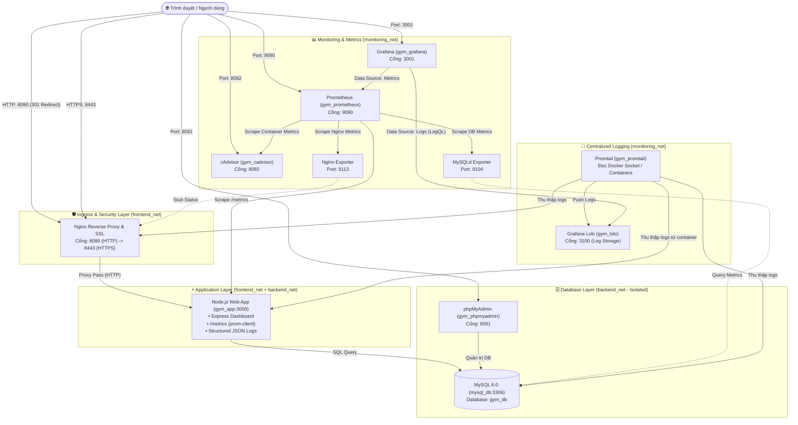

# 🏋️ GymManagement - Hệ Thống Quản Lý Phòng Gym & Fitness
> **Kiến trúc Multi-Container Microservices với Docker Compose, Nginx Reverse Proxy (SSL/TLS), Giám sát Toàn diện (Prometheus & Grafana) và Quản lý Log Tập trung (Loki & Promtail).**

[](https://docs.docker.com/compose/)
[](https://nodejs.org/)
[](https://nginx.org/)
[](https://www.mysql.com/)
[](https://prometheus.io/)
[](https://grafana.com/)
[](https://grafana.com/oss/loki/)

---

## 📖 Mục Lục
1. [Tổng Quan Dự Án](#-tổng-quan-dự-án)
2. [Sơ Đồ Kiến Trúc Hệ Thống](#-sơ-đồ-kiến-trúc-hệ-thống)
3. [Công Nghệ Sử Dụng](#-công-nghệ-sử-dụng)
4. [Danh Sách Dịch Vụ & Cổng Truy Cập](#-danh-sách-dịch-vụ--cổng-truy-cập)
5. [Cấu Trúc Thư Mục](#-cấu-trúc-thư-mục)
6. [Các Tính Năng Của Ứng Dụng](#-các-tính-năng-của-ứng-dụng)
7. [Hệ Thống Giám Sát & Ghi Log (Observability)](#-hệ-thống-giám-sát--ghi-log-observability)
8. [Cơ Chế Bảo Mật (Security Hardening)](#-cơ-chế-bảo-mật-security-hardening)
9. [Hướng Dẫn Cài Đặt & Vận Hành](#-hướng-dẫn-cài-đặt--vận-hành)
10. [Thông Tin Đăng Nhập & Truy Cập](#-thông-tin-đăng-nhập--truy-cập)
11. [Tác Giả](#-tác-giả)

---

## 📌 Tổng Quan Dự Án

**GymManagement** là giải pháp phần mềm quản trị phòng tập Gym & Fitness hiện đại, đáp ứng đầy đủ các tiêu chuẩn vận hành thực tế của một hệ thống doanh nghiệp:
- **Quản lý toàn diện**: Theo dõi danh sách hội viên, đăng ký thẻ tập mới, quản lý gói tập, đội ngũ huấn luyện viên (PT) và xếp lịch biểu tập luyện.
- **Bảng điều khiển trực quan**: Báo cáo tổng quan số lượng, cơ cấu mục tiêu rèn luyện và gói cước kèm chỉ số tải phần cứng máy chủ theo thời gian thực (CPU, RAM).
- **Hạ tầng Container hóa**: Đóng gói và cô lập toàn bộ các thành phần (App, Database, Proxy, Monitoring, Logging) bằng Docker Compose, giúp việc triển khai (deployment) diễn ra nhanh chóng, đồng nhất và tin cậy trên mọi môi trường.
- **Giám sát & Quản trị Log chuyên sâu**: Tích hợp sẵn bộ công cụ Observability chuẩn Cloud-Native gồm Prometheus, Grafana, cAdvisor, Exporters, Loki và Promtail.

---

## 🏛️ Sơ Đồ Kiến Trúc Hệ Thống

Hệ thống được thiết kế theo mô hình phân tầng bảo mật với 3 mạng Docker (`frontend_net`, `backend_net` [internal], `monitoring_net`):



---

## 🛠️ Công Nghệ Sử Dụng

| Lĩnh Vực | Công Nghệ & Phiên Bản | Vai Trò Trong Dự Án |
|---|---|---|
| **Backend & App** | Node.js 20 (Alpine), Express.js 4.19 | Xây dựng API và render giao diện Dashboard quản lý |
| **Cơ Sở Dữ Liệu** | MySQL 8.0 Community Server | Lưu trữ quan hệ dữ liệu Hội viên, Gói cước, HLV, Lịch tập |
| **Quản Trị DB** | phpMyAdmin (Latest) | Giao diện đồ họa truy vấn và kiểm tra cơ sở dữ liệu |
| **Web Server / Proxy** | Nginx Alpine, OpenSSL | Reverse Proxy, SSL/TLS Termination, bảo vệ Header an toàn |
| **Giám Sát (Metrics)** | Prometheus, cAdvisor, Nginx Exporter, MySQLd Exporter | Thu thập và quản lý số liệu hệ thống định kỳ (scrape 15s) |
| **Trực Quan Hóa** | Grafana (Latest) | Xây dựng Dashboard biểu đồ giám sát và truy vấn LogQL |
| **Quản Lý Log** | Grafana Loki 3.0, Promtail 3.0 | Thu thập log container tập trung qua Docker Socket và lập chỉ mục |
| **Thư Viện Giao Diện** | Bootstrap 5, Chart.js, Vanilla CSS | Thiết kế giao diện hiện đại, responsive và trực quan |
| **Đóng Gói & Điều Phối** | Docker & Docker Compose v2 | Thiết lập cụm 11 containers với phân tách mạng độc lập |

---

## 🌐 Danh Sách Dịch Vụ & Cổng Truy Cập

| Dịch Vụ (Service) | Container Name | Cổng Host : Container | Mạng Kết Nối | Mục Đích Sử Dụng |
|---|---|---|---|---|
| **Nginx Proxy** | `gym_nginx` | `8080:80`<br>`8443:443` | `frontend_net` | Điểm truy cập chính của ứng dụng web (Hỗ trợ HTTPS và tự động redirect) |
| **Web App** | `gym_app` | *(Nội bộ: 3000)* | `frontend_net`<br>`backend_net` | Ứng dụng Node.js quản lý phòng gym & xuất `/metrics` |
| **MySQL DB** | `gym_mysql` | *(Nội bộ: 3306)* | `backend_net` | Cơ sở dữ liệu chính (được cô lập hoàn toàn khỏi mạng ngoài) |
| **phpMyAdmin** | `gym_phpmyadmin` | `8081:80` | `frontend_net`<br>`backend_net` | Giao diện web quản trị cơ sở dữ liệu MySQL |
| **Prometheus** | `gym_prometheus` | `9090:9090` | `frontend_net`<br>`backend_net`<br>`monitoring_net` | Server giám sát và thu thập Time-Series Metrics |
| **Grafana** | `gym_grafana` | `3001:3000` | `monitoring_net` | Nền tảng trực quan hóa Metrics & Logs |
| **cAdvisor** | `gym_cadvisor` | `8082:8080` | `monitoring_net` | Giám sát tài nguyên phần cứng (CPU/RAM/IO) của các container Docker |
| **Nginx Exporter** | `gym_nginx_exporter`| *(Nội bộ: 9113)* | `frontend_net`<br>`monitoring_net` | Chuyển đổi Nginx `stub_status` thành định dạng Prometheus |
| **MySQL Exporter** | `gym_mysqld_exporter`| *(Nội bộ: 9104)* | `backend_net`<br>`monitoring_net` | Trích xuất các chỉ số hiệu năng và kết nối từ MySQL |
| **Grafana Loki** | `gym_loki` | `3100:3100` | `monitoring_net` | Kho lưu trữ và truy vấn log tập trung |
| **Promtail** | `gym_promtail` | *(Nội bộ: 9080)* | `monitoring_net` | Agent tự động bắt log từ Docker daemon đẩy về Loki |

---

## 📂 Cấu Trúc Thư Mục

```text
MSSV_GymManagement/
├── .env                         # File cấu hình biến môi trường và mật khẩu (Database, Grafana)
├── .env.example                 # File mẫu cấu hình biến môi trường
├── .gitignore                   # Cấu hình bỏ qua các thư mục tạm (node_modules/)
├── docker-compose.yml           # File điều phối khởi chạy toàn bộ cụm 11 containers
├── README.md                    # Tài liệu hướng dẫn chi tiết dự án
│
├── app/                         # Mã nguồn ứng dụng Web Node.js
│   ├── Dockerfile               # Khởi tạo container Node.js non-root (gymuser)
│   ├── package.json             # Khai báo dependencies (express, mysql2, prom-client)
│   └── server.js                # Core server: routing, database pool, prometheus counter, HTML dashboard
│
├── monitoring/                  # Thư mục cấu hình hệ thống Observability
│   ├── .my.cnf                  # Thông tin tài khoản xác thực cho MySQLd Exporter
│   ├── loki-config.yaml         # Cấu hình hệ thống lưu trữ log Loki
│   ├── prometheus.yml           # Khai báo các Job Scrape định kỳ cho Prometheus
│   └── promtail-config.yaml     # Cấu hình phát hiện container và thu thập log của Promtail
│
├── mysql/                       # Cơ sở dữ liệu
│   └── init.sql                 # DDL khởi tạo bảng & dữ liệu mẫu cho phòng gym
│
└── nginx/                       # Cấu hình Web Server Nginx & Chứng chỉ SSL
    ├── nginx.conf               # Thiết lập Reverse Proxy, SSL, Security Headers, stub_status
    └── ssl/
        ├── selfsigned.crt       # Chứng chỉ số SSL (Certificate)
        └── selfsigned.key       # Khóa bí mật SSL (Private Key)
```

---

## ✨ Các Tính Năng Của Ứng Dụng

Ứng dụng Gym Management được trang bị giao diện Single-Page Dashboard với thanh điều hướng tiện lợi:

1. **📊 Thống kê (Dashboard Tổng Quan)**:
   - Các thẻ chỉ số chính: Tổng số hội viên, tổng số gói tập đang mở bán, tổng số huấn luyện viên cá nhân (PT).
   - Đo tải máy chủ theo thời gian thực: Hiển thị thanh tiến trình mức chiếm dụng **CPU (%)** và **RAM (MB / %)**.
   - Biểu đồ số lượng hội viên theo gói tập (**Chart.js Bar Chart**).
   - Biểu đồ phân loại mục tiêu tập luyện: Tăng cơ, Giảm mỡ, Yoga & Trị liệu, Cardio, Thể lực (**Chart.js Doughnut Chart**).

2. **🧑 Quản Lý Hội Viên (Members)**:
   - Bảng danh sách hội viên: Mã định danh tự động (`GYM245200xx`), Họ và tên, Số điện thoại, Gói tập đăng ký, Ngày tham gia.
   - Form đăng ký hội viên mới trực tiếp: Tự động lưu vào cơ sở dữ liệu MySQL và cập nhật ngày đăng ký theo thời gian thực (`CURDATE()`).

3. **💳 Danh Sách Gói Tập (Packages)**:
   - Hiển thị danh mục các gói cước đang áp dụng tại trung tâm (Gói Cơ Bản, Gói Nâng Cao, Gói Chuyên Sâu PT 1-1, Gói VIP Toàn Năng, Gói Sinh Viên ICTU, Gói Cardio & Giảm Mỡ, Gói Tập Nhóm Group X).
   - Chi tiết thời hạn gói (1 tháng, 3 tháng, 6 tháng, 12 tháng) và mức học phí tương ứng (VNĐ).

4. **💪 Đội Ngũ Huấn Luyện Viên (Trainers / PT)**:
   - Danh sách huấn luyện viên thể hình chuyên nghiệp.
   - Hiển thị đầy đủ Họ tên, Lĩnh vực chuyên môn (Thể hình, Yoga, Cardio, CrossFit) và Số điện thoại liên hệ.

5. **📅 Lịch Tập Hội Viên & PT (Schedules)**:
   - Quản lý việc sắp xếp khung giờ tập giữa hội viên và HLV.
   - Ghi chú lộ trình tập luyện (ví dụ: *Tăng cơ chuyên sâu*, *Yoga trị liệu cột sống*, *Cardio đốt mỡ*), các ngày trong tuần và khung thời gian chi tiết.

6. **🛠️ Endpoints Hỗ Trợ Kỹ Thuật**:
   - `GET /metrics`: Xuất các chỉ số hệ thống (Metrics) theo chuẩn Prometheus.
   - `GET /error-test`: Endpoint chủ động trả về mã lỗi `500` và ghi log JSON cấu trúc `ERROR` để kiểm thử hệ thống giám sát cảnh báo và truy vấn LogQL trên Grafana Loki.

---

## 📈 Hệ Thống Giám Sát & Ghi Log (Observability)

### 1. Prometheus Scrape Configurations
Prometheus thực hiện kiểm tra và lấy chỉ số định kỳ mỗi **15 giây** (`scrape_interval: 15s`) từ 5 mục tiêu:
- `prometheus`: Tự giám sát chính Prometheus server (`localhost:9090`).
- `gym_web_app`: Lấy chỉ số từ ứng dụng Node.js (`gym_app:3000/metrics`) bao gồm số lượng kết nối, heap memory, và custom counter `gym_http_requests_total`.
- `cadvisor_containers`: Thu thập chỉ số hiệu năng CPU/RAM/Network/Disk của từng container Docker.
- `nginx_webserver`: Thu thập số liệu hoạt động của Nginx thông qua `nginx_exporter:9113`.
- `mysql_database`: Thu thập số liệu query, connection, buffer pool qua `mysqld_exporter:9104`.

### 2. Centralized Logging với Loki & Promtail
- Mọi request đến ứng dụng `gym_app` đều được serialize dưới dạng **JSON Log** tiêu chuẩn:
  ```json
  {"timestamp":"2026-10-22T10:00:00.000Z","level":"INFO","method":"GET","path":"/","status":200}
  ```
- Promtail lắng nghe socket Docker (`/var/run/docker.sock`), tự động gán nhãn container (`container="gym_app"`, `stream="stdout/stderr"`) và gửi về Loki.
- **Một số câu truy vấn LogQL mẫu trong Grafana**:
  - Xem tất cả log của Web App:
    ```logql
    {container="gym_app"}
    ```
  - Lọc riêng các bản ghi lỗi:
    ```logql
    {container="gym_app"} |= "ERROR"
    ```
  - Parse JSON và lọc theo mã trạng thái HTTP:
    ```logql
    {container="gym_app"} | json | status >= 400
    ```
  - Đếm tần suất lỗi trong mỗi 1 phút:
    ```logql
    rate({container="gym_app"} |= "ERROR" [1m])
    ```

---

## 🔒 Cơ Chế Bảo Mật (Security Hardening)

Dự án áp dụng các nguyên tắc bảo mật công nghiệp nhằm đảm bảo an toàn thông tin:
1. **Cô lập Cơ sở Dữ liệu (Network Isolation)**:
   - Mạng `backend_net` được đánh dấu `internal: true`. Cổng `3306` của MySQL không bao giờ phơi bày ra máy tính bên ngoài host, ngăn ngừa các cuộc tấn công quét cổng hoặc brute-force từ bên ngoài.
2. **Quyền hạn tối thiểu (Principle of Least Privilege)**:
   - Container `gym_app` được cấu hình chạy bằng user không đặc quyền (`USER gymuser:gymgroup`), hạn chế tối đa nguy cơ chiếm quyền root container.
   - Kích hoạt cơ chế `security_opt: - no-new-privileges:true` cho cả `gym_app` và `nginx_proxy` để ngăn chặn các tiến trình con leo thang đặc quyền.
3. **Mã hóa đường truyền (HTTPS & SSL/TLS)**:
   - Nginx cấu hình giao thức `TLSv1.2` và `TLSv1.3`.
   - Toàn bộ truy cập HTTP cổng `8080` tự động được chuyển hướng (HTTP 301) sang cổng bảo mật HTTPS `8443`.
4. **Bảo vệ bằng Security Headers**:
   - `X-Frame-Options: SAMEORIGIN`: Ngăn chặn tấn công Clickjacking.
   - `X-Content-Type-Options: nosniff`: Chống tấn công qua MIME-type sniffing.
   - `Referrer-Policy: strict-origin-when-cross-origin`: Bảo vệ thông tin liên kết chuyển tiếp.
   - `Cross-Origin-Opener-Policy: same-origin`: Cô lập browsing context.
5. **Kiểm soát truy cập Endpoint nhạy cảm**:
   - Endpoint `/nginx_status` chỉ cho phép các dải IP Private nội bộ (`172.16.0.0/12`, `192.168.0.0/16`, `10.0.0.0/8`) truy cập, từ chối toàn bộ yêu cầu từ bên ngoài.

---

## 🚀 Hướng Dẫn Cài Đặt & Vận Hành

### Yêu Cầu Tiên Quyết
- Đã cài đặt **Git**.
- Đã cài đặt **Docker Desktop** (trên Windows/macOS) hoặc **Docker Engine & Docker Compose** (trên Linux).

### Bước 1: Sao chép mã nguồn (Clone Repository)
```bash
git clone https://github.com/ngoxuanminhhieu-ux/GymManagement.git
cd MSSV_GymManagement
```

### Bước 2: Thiết lập cấu hình biến môi trường
Kiểm tra file `.env` đã có sẵn trong thư mục dự án hoặc tạo mới từ file mẫu `.env.example`:
```bash
# Trên Windows PowerShell
Copy-Item .env.example .env

# Hoặc trên Linux / macOS
cp .env.example .env
```

### Bước 3: (Tùy chọn) Khởi tạo lại Chứng chỉ SSL tự ký
Nếu cần làm mới chứng chỉ SSL trong thư mục `nginx/ssl/`, chạy lệnh OpenSSL sau:
```bash
openssl req -x509 -nodes -days 365 -newkey rsa:2048 \
  -keyout nginx/ssl/selfsigned.key \
  -out nginx/ssl/selfsigned.crt \
  -subj "/C=VN/ST=ThaiNguyen/L=ThaiNguyen/O=GymManagement/CN=localhost"
```

### Bước 4: Khởi động toàn bộ cụm Container
Khởi động hệ thống ở chế độ chạy nền (detached mode):
```bash
docker compose up -d --build
```

### Bước 5: Kiểm tra trạng thái hoạt động
Kiểm tra xem tất cả các containers đã ở trạng thái `running`:
```bash
docker compose ps
```

### Bước 6: Theo dõi nhật ký hoạt động (Logs)
```bash
# Xem log của ứng dụng web
docker compose logs -f gym_app

# Xem log của Nginx Reverse Proxy
docker compose logs -f nginx_proxy
```

### Bước 7: Dừng hệ thống khi không sử dụng
```bash
# Dừng các container nhưng giữ lại dữ liệu volume (MySQL data)
docker compose down

# Dừng và xóa toàn bộ volume dữ liệu (nếu muốn reset sạch DB)
docker compose down -v
```

---

## 🔑 Thông Tin Đăng Nhập & Truy Cập

| Ứng Dụng / Dịch Vụ | Đường Dẫn URL | Tài Khoản Đăng Nhập | Mật Khẩu |
|---|---|---|---|
| **Gym Management (HTTPS)** | [https://localhost:8443](https://localhost:8443) | *Không yêu cầu* | *Không yêu cầu* |
| **Gym Management (HTTP)** | [http://localhost:8080](http://localhost:8080) | *(Tự động chuyển tiếp sang HTTPS 8443)* | — |
| **phpMyAdmin** | [http://localhost:8081](http://localhost:8081) | `gym_app_user` | `GymUser@2026#AppPass!` |
| **phpMyAdmin (Root)** | [http://localhost:8081](http://localhost:8081) | `root` | `GymRoot@2026#StrongPass!` |
| **Grafana Dashboard** | [http://localhost:3001](http://localhost:3001) | `admin_gym` | `Grafana@2026#Secure!` |
| **Prometheus Web UI** | [http://localhost:9090](http://localhost:9090) | *Không yêu cầu* | *Không yêu cầu* |
| **cAdvisor UI** | [http://localhost:8082](http://localhost:8082) | *Không yêu cầu* | *Không yêu cầu* |
| **Loki API Status** | [http://localhost:3100/ready](http://localhost:3100/ready) | *Không yêu cầu* | *Không yêu cầu* |
| **Endpoint Thử Nghiệm Lỗi** | [https://localhost:8443/error-test](https://localhost:8443/error-test) | *Tạo bản ghi lỗi cho LogQL* | — |

> [!NOTE]
> Khi truy cập giao diện qua `https://localhost:8443`, do sử dụng chứng chỉ SSL tự ký (Self-signed Certificate), trình duyệt sẽ đưa ra cảnh báo bảo mật. Hãy bấm chọn **Advanced (Nâng cao)** -> **Proceed to localhost (Tiếp tục truy cập)** để vào giao diện ứng dụng.

---

## 👨‍💻 Tác Giả

- **Sinh viên thực hiện**: Ngô Xuân Minh Hiếu
- **Khoa / Trường**: Đại học Công nghệ Thông tin & Truyền thông (ICTU)
- **Repository**: [ngoxuanminhhieu-ux/GymManagement](https://github.com/ngoxuanminhhieu-ux/GymManagement)

---
*Tài liệu được xây dựng chi tiết phục vụ cho mục đích học tập, nghiên cứu và triển khai thực tế hệ thống Quản trị Phòng Gym đa dịch vụ.*
